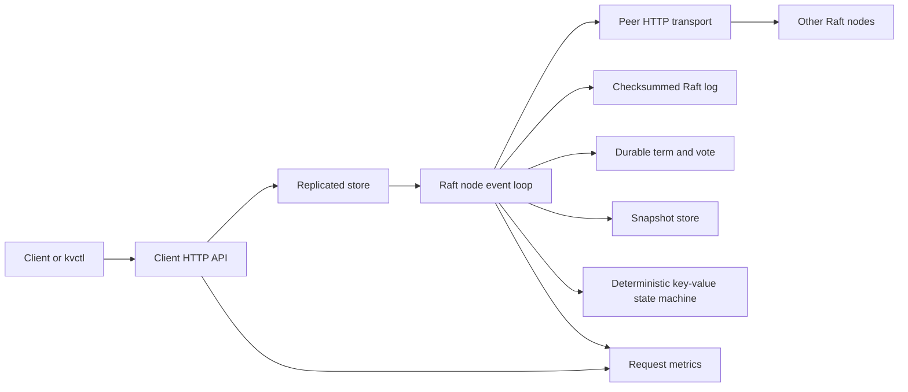

# Architecture walkthrough

The API accepts opaque byte values under string keys. In standalone mode it
writes a WAL record, flushes it, applies the mutation to the in-memory map, and
then acknowledges the client. In cluster mode the replicated store encodes the
same mutation as a Raft command.

One goroutine owns each Raft node's mutable consensus state. Timers, client
proposals, peer requests, and peer responses enter that event loop. Candidates
persist their term and vote before requesting votes. Leaders append locally,
replicate to peers, advance the commit index only when a current-term entry is
stored on a quorum, and apply commands in index order. A proposal returns only
after its entry is committed and applied locally.

Linearizable reads use a quorum read barrier. A leader confirms authority in
its current term and waits for local application through the confirmed commit
index. Followers reject client operations with a leader hint. A timed-out
mutation remains ambiguous because the command may commit after the caller
stops waiting.

Hard state, log files, and snapshots use checksums. Replacement uses a flushed
temporary file, atomic rename, and parent-directory synchronization. A snapshot
is published before its covered log prefix is compacted. A follower behind the
compacted boundary installs the snapshot and then receives the retained suffix.

The failure injector wraps outbound transport and lifecycle control, leaving
Raft unaware of tests. The correctness oracle independently records client
outcomes and replica observations, checks overlapping committed prefixes and
final applied-state convergence, and can write deterministic JSON traces.

## Important invariants

- A node grants at most one vote per term, and only to a candidate with a log at
  least as fresh as its own.
- Only a leader with quorum replication of a current-term entry advances commit.
- State machines apply committed commands once, in increasing index order.
- A minority cannot acknowledge a new write or confirm a linearizable read.
- A successful mutation response follows durable commitment and local apply.
- Compaction never removes entries before a covering snapshot is durable.

Code entry points are the [Raft event loop](../internal/raft/node.go),
[replicated store](../internal/database/replicated.go), [peer HTTP
transport](../internal/transport/http.go), and [snapshot
store](../internal/snapshot/store.go).
